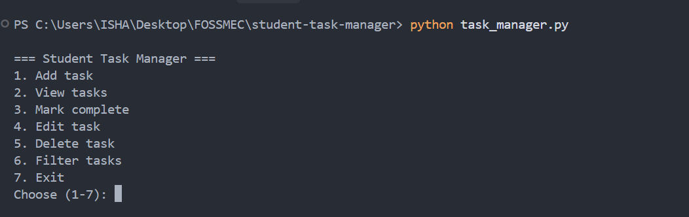
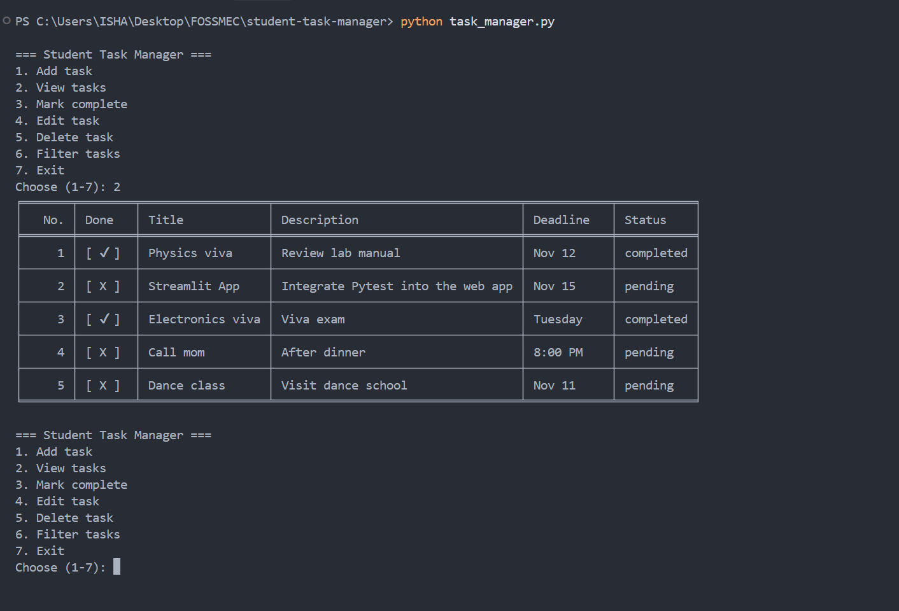
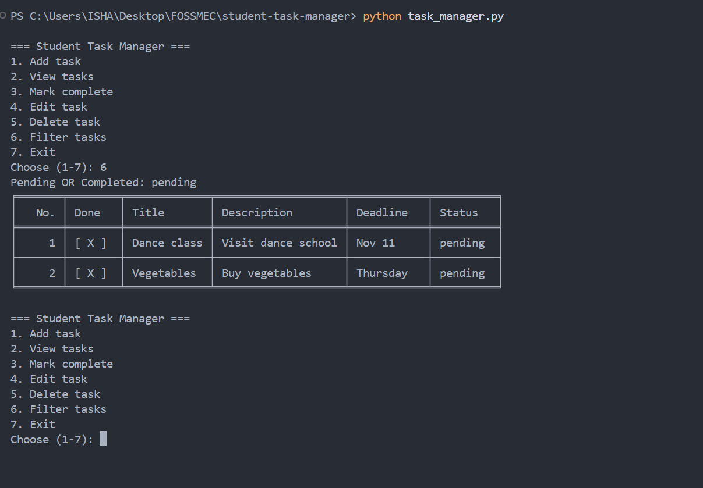
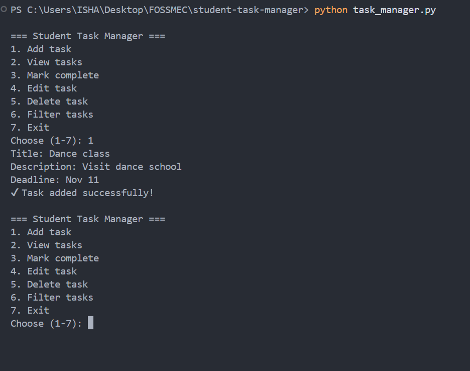
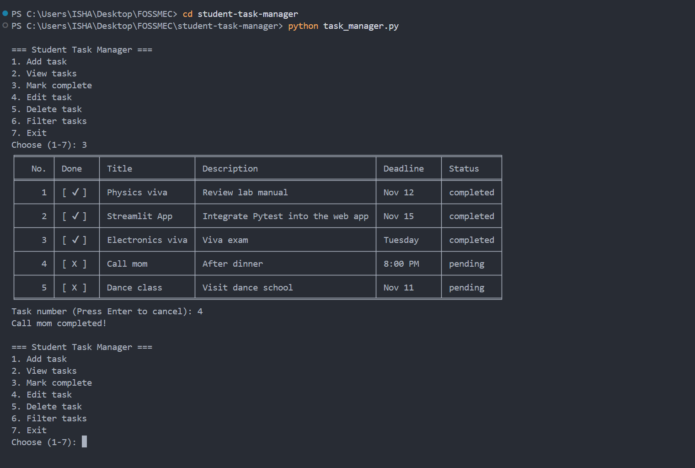
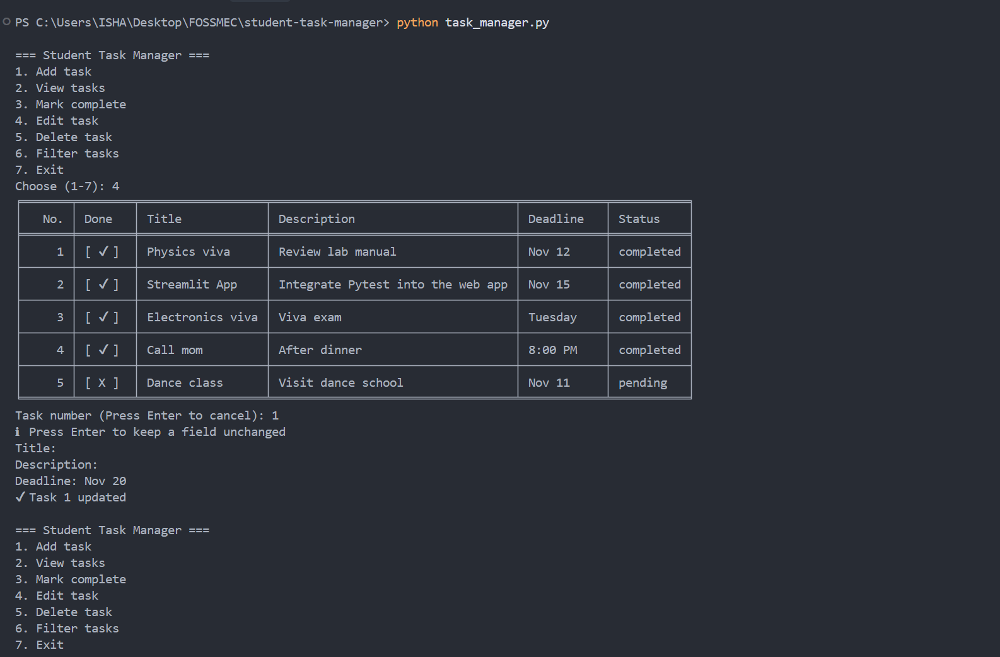
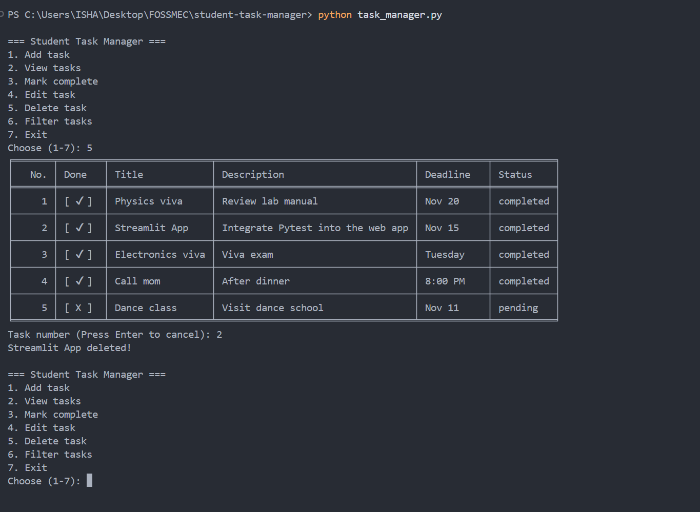
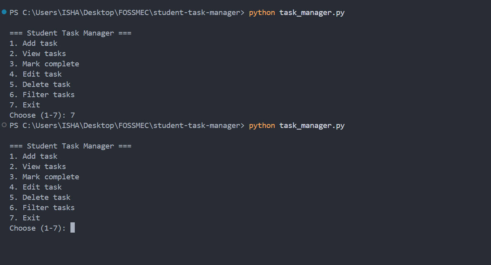
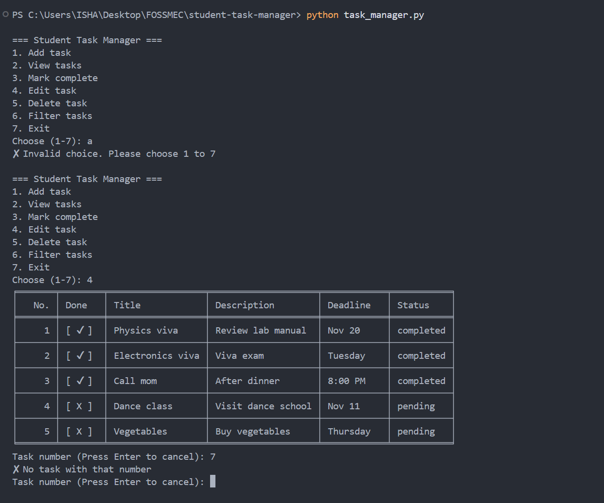

# 📝 Student Task Manager


> A command-line task manager in Python. Add, edit, delete and filter tasks, and they're saved for next time.

---

## Features

- **Add** a task with a title, description and deadline
- **View** all tasks in a table with their status
- **Mark** a task as completed
- **Edit** a task (press Enter to keep a field unchanged)
- **Delete** a task
- **Filter** tasks by pending or completed
- **Saved storage:** tasks are stored in `tasks.json`
- Input checks: empty fields, invalid task numbers and a damaged data file are handled without crashing

## Requirements

- Python 3 (tested on Python 3.14)
- The `tabulate` library (listed in `requirements.txt`)

## Setup

1. Clone the repository:
   ```
   git clone https://github.com/ivantagedev-code/student-task-manager.git
   cd student-task-manager
   ```
2. Install the requirement:
   ```
   pip install -r requirements.txt
   ```

## How to run

```
python task_manager.py
```

## How to use

You will see this menu:

```
=== Student Task Manager ===
1. Add task
2. View tasks
3. Mark complete
4. Edit task
5. Delete task
6. Filter tasks
7. Exit
```

| Option | What it does |
|--------|--------------|
| 1 | Asks for a title, description and deadline, then saves the task as pending |
| 2 | Shows all tasks in a table |
| 3 | Shows the tasks, then asks for a task number to mark as completed |
| 4 | Asks for a task number, then lets you change the title, description or deadline. Press Enter to keep the old value |
| 5 | Asks for a task number and deletes that task |
| 6 | Shows only pending or only completed tasks |
| 7 | Exits the program |

When asked for a task number, press Enter to cancel and go back to the menu.

## 📸 Screenshots

**Menu**



**View tasks**



**Filter tasks**



<details>
<summary>Click to see more screenshots</summary>

**Adding a task**



**Marking a task complete**



**Editing a task**



**Deleting a task**



**Tasks are still there after restarting**



**Invalid input is handled**



</details>

## How the data is saved

Tasks are stored as a list of dictionaries in `tasks.json`, in the same folder as the program. The file is created the first time a task is saved. If the file is missing, the program starts with an empty list. If it is damaged, the program shows a message and starts empty.

## Notes

- When you filter, the numbers start from 1 again. They are only for display and do not match the numbers in the full list.


