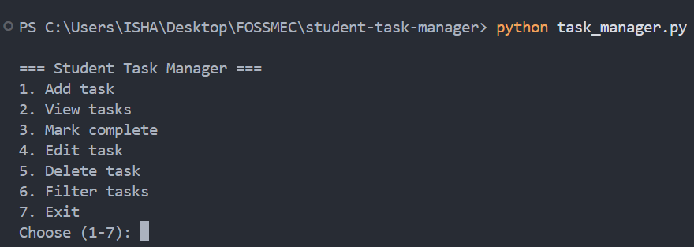
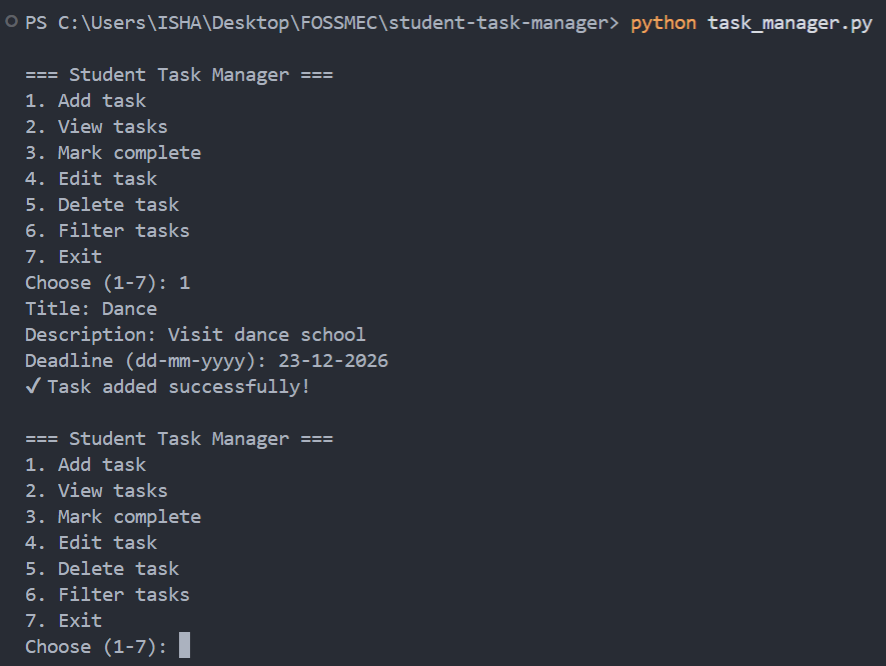
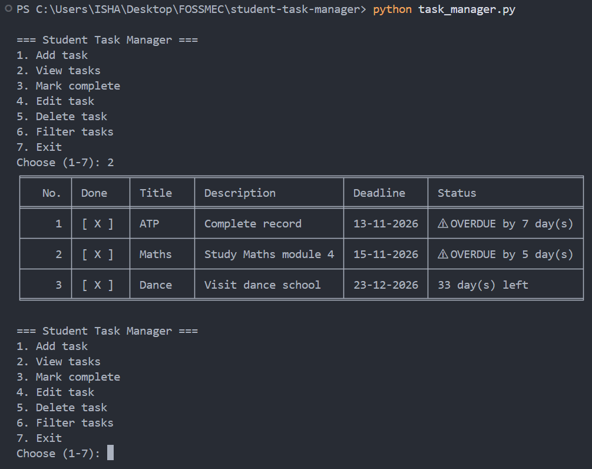
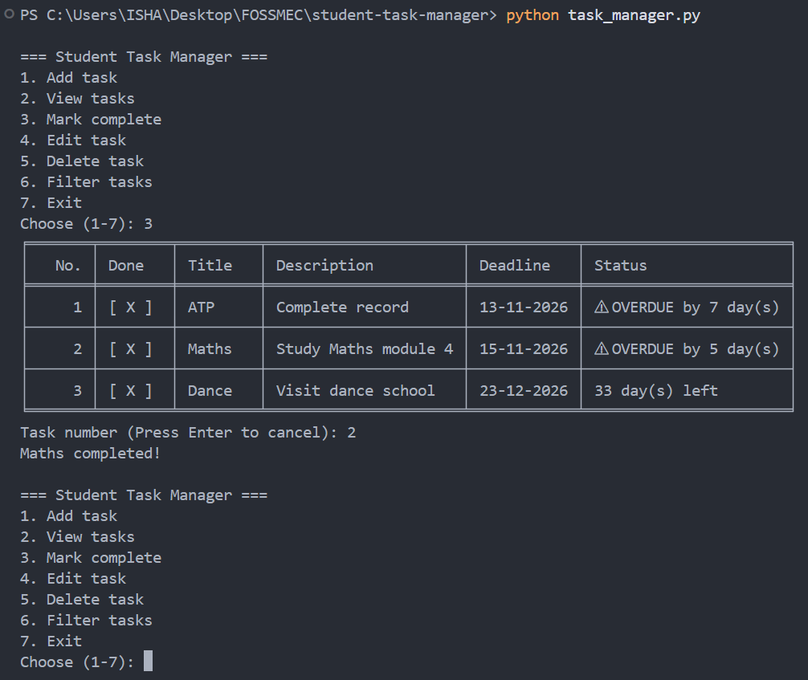
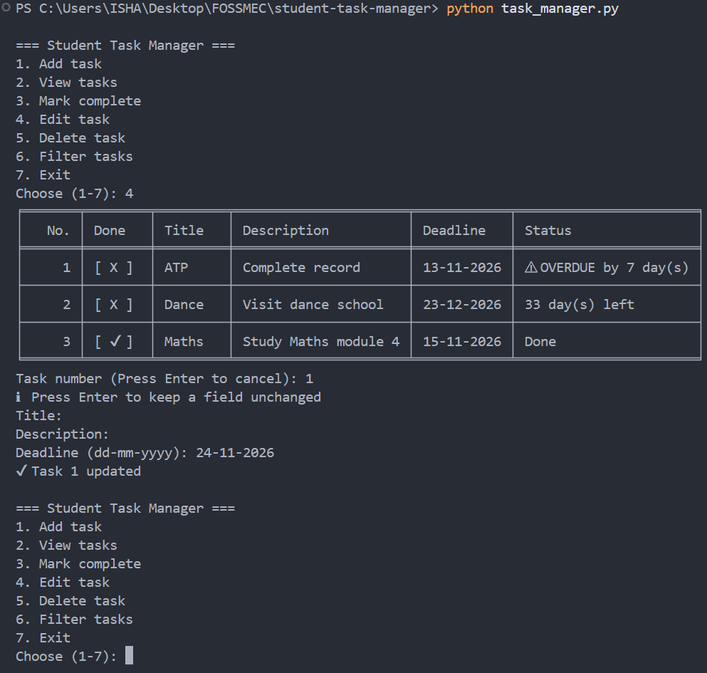
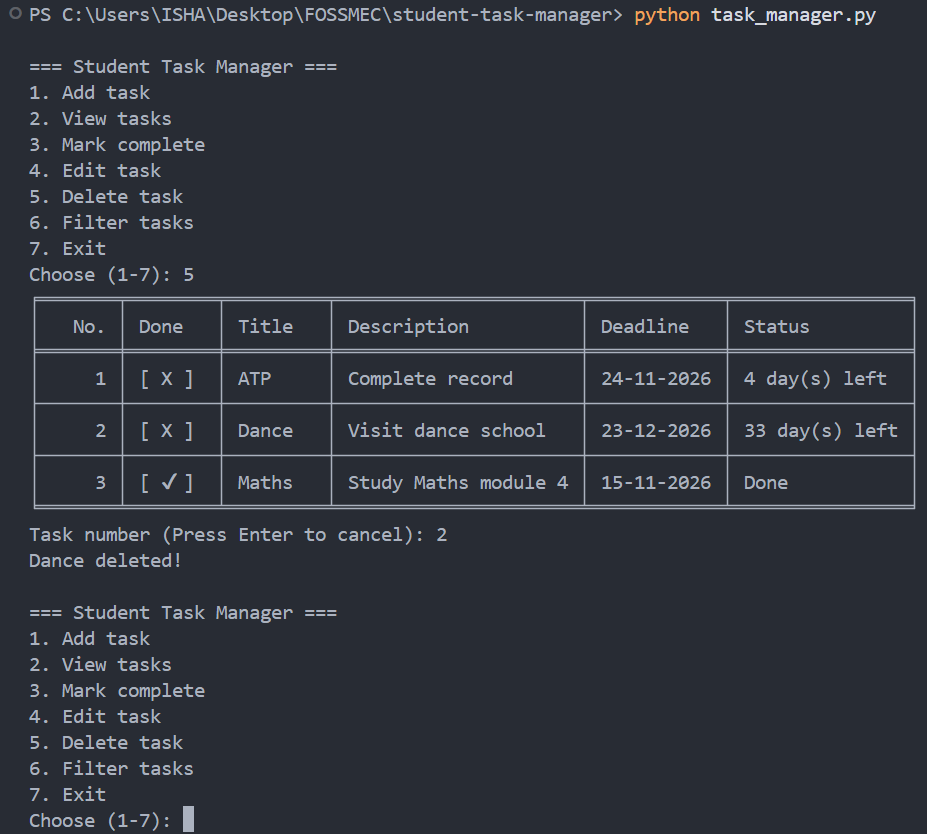
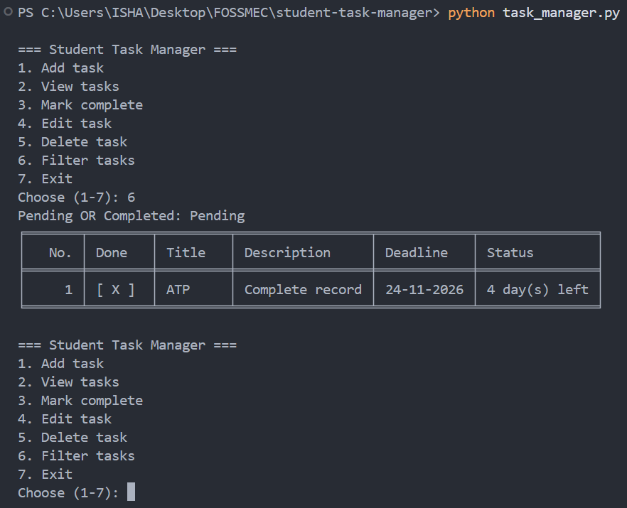
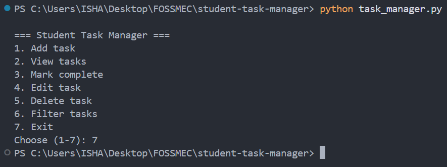
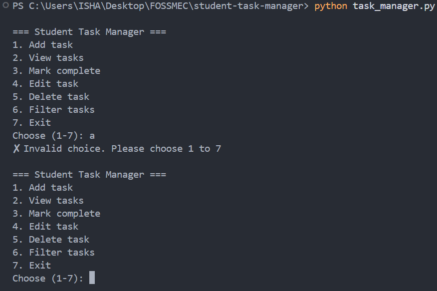

<div align="center">

# Student Task Manager

A command-line task manager for students to track assignments and deadlines.


</div>

---

## About

Student Task Manager helps you keep track of assignments and deadlines from the terminal. It shows how many days are left for each task, warns you when something is overdue, and saves everything to a file so your list is still there the next time you open it.


## Features

- ➕ Add tasks with a title, description and deadline
- 📋 View tasks in a table, sorted by deadline (completed tasks go to the bottom)
- ⏳ Days-left counter, "Due today" and overdue warnings
- ✅ Mark tasks as complete
- ✏️ Edit tasks (press Enter to keep a field unchanged)
- 🗑️ Delete tasks
- 🔍 Filter tasks by pending or completed
- 💾 Automatic saving to `tasks.json`
- 🛡️ Input validation for empty fields, wrong task numbers and invalid dates
- 🔄 Safe start if the save file is missing or damaged

## Setup

**Requirements:** Python 3.6 or higher

```bash
git clone https://github.com/ivantagedev-code/student-task-manager.git
cd student-task-manager
pip install -r requirements.txt
python task_manager.py
```

`requirements.txt` installs [`tabulate`](https://pypi.org/project/tabulate/). The `json` and `datetime` modules come with Python.

## Commands

The program opens a menu. Type a number and press Enter.

| Option | Command | What it does |
|--------|---------|--------------|
| 1 | Add task | Asks for title, description and deadline (`dd-mm-yyyy`) |
| 2 | View tasks | Shows all tasks in a table |
| 3 | Mark complete | Marks the chosen task as completed |
| 4 | Edit task | Changes title, description or deadline |
| 5 | Delete task | Removes the chosen task |
| 6 | Filter tasks | Shows only `pending` or `completed` tasks |
| 7 | Exit | Closes the program |

When asked for a task number, press Enter without typing anything to cancel.

## Screenshots

**Main menu**



**Adding a task**



**Viewing tasks**



<details>
<summary><b>Click to view more screenshots</b></summary>

<br>

**Marking a task complete**



**Editing a task**



**Deleting a task**



**Filtering tasks**



**Exiting the program**



**Input validation (error handling)**



</details>

## How data is stored

Tasks are saved in `tasks.json` next to the program. Each task looks like this:

```json
{
 "title": "Physics lab",
 "description": "Finish the record",
 "deadline": "25-11-2026",
 "status": "pending"
}
```


## Project structure

```
.
├── screenshots/
├── .gitignore
├── LICENSE
├── NOTES.md
├── README.md
├── requirements.txt
├── task_manager.py
└── tasks.json        # created automatically

```

See [NOTES.md](NOTES.md) for design choices and AI usage.


## License

This project is licensed under the MIT License.